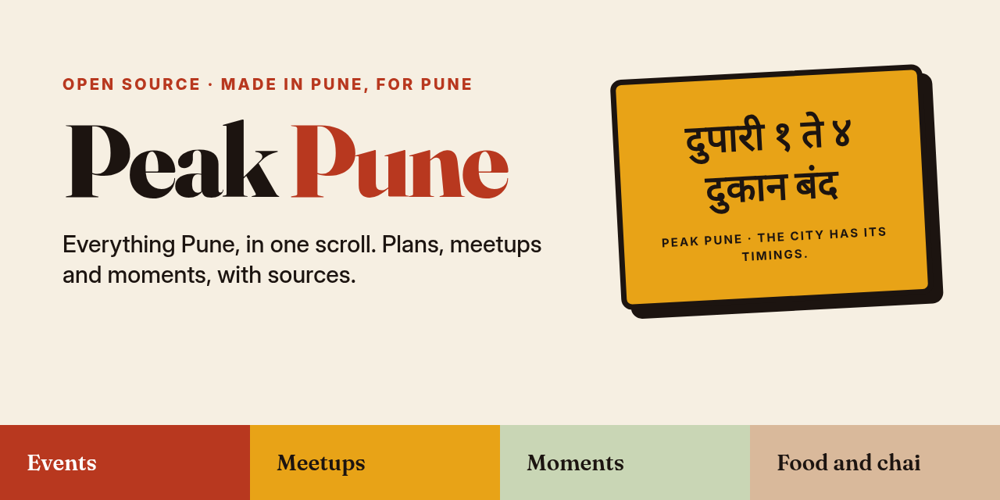
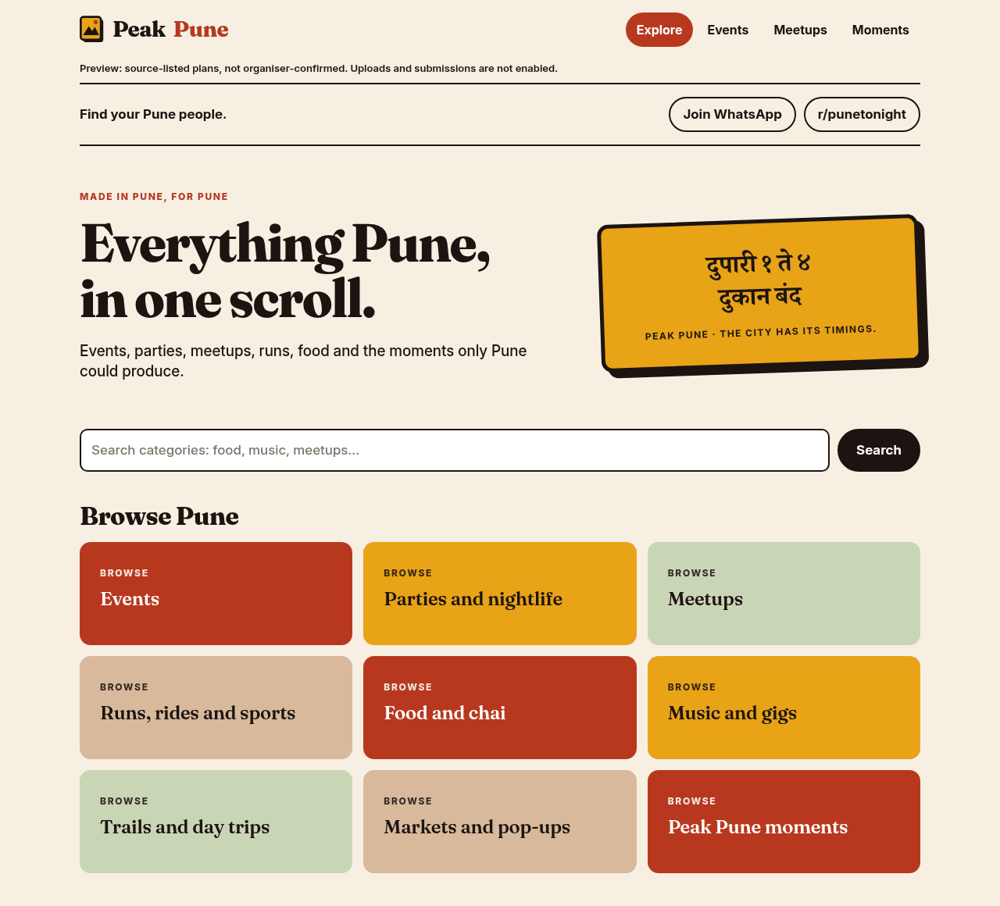
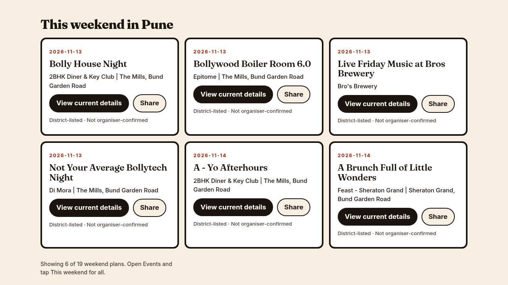
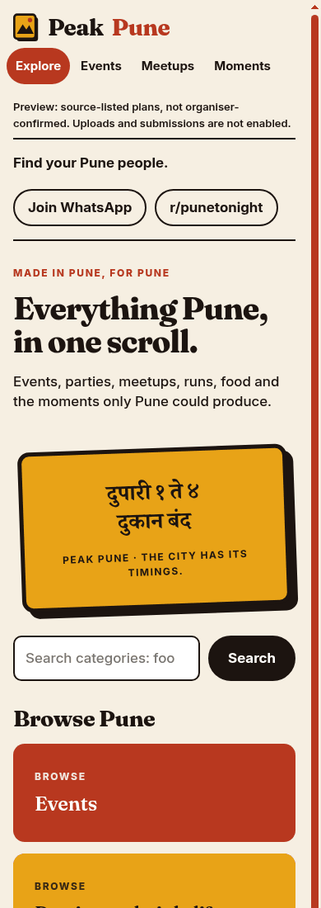
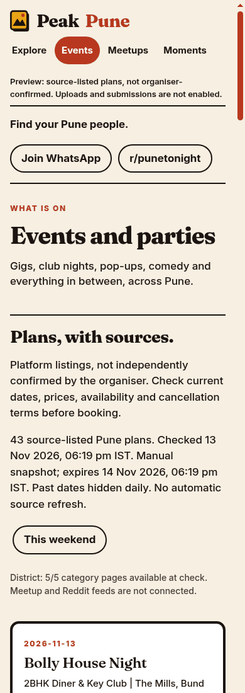

<p align="center">
  
</p>

<p align="center">
  <a href="https://peakpune.com/"><b>peakpune.com</b></a> &nbsp;·&nbsp;
  <a href="CONTRIBUTING.md">Contribute</a> &nbsp;·&nbsp;
  <a href="docs/SCOPE.md">Scope and brand</a> &nbsp;·&nbsp;
  <a href="docs/PLANS.md">Plans data</a> &nbsp;·&nbsp;
  <a href="SECURITY.md">Security</a>
</p>

<p align="center">
  
  
  
  
</p>

# Peak Pune

An open-source website for local events, meetups and moments in Pune, with the Puneri
attitude. It is a small static site: plain HTML, CSS and JavaScript, no framework, no build
on deploy and no tracking.

> **Status: live.** Listings are source-checked, not a promise of current availability.
> Search indexing and reader submissions remain disabled. No personal data is collected.

## What works today

| Area | State |
| --- | --- |
| **Explore** | A "This weekend in Pune" section built from real listings, featured places, runs and treks. |
| **Places** | 28 source-backed Pune places, with one page each and pages by area. Unconfirmed hours and prices are omitted. |
| **Outdoors** | 8 mapped running loops and 20 treks and day trips with sourced distance and drive-time details where available, credited to PuneRunners Club and Pune Trekkers. |
| **Events** | A reviewed snapshot of Pune plans listed on District, each linking to its original listing. A **This weekend** filter uses only the listed date. A **Share** button on each plan shares or copies the original link. |
| **Meetups** | 7 communities with current source evidence and public joining pages. Unconfirmed activity listings are withheld. |
| **Moments** | No genuine submitted moments published yet. Generated captions removed; reader submissions remain closed. |
| **Submissions, uploads, accounts** | Not enabled. There is no backend. |

Plans are source-listed, not confirmed by organisers. Always check the original listing for
current dates, prices and availability. Nothing here promises live availability, and unknown
prices are never shown as "Free".

The publication decisions and corrections are recorded in [`docs/LISTING-AUDIT.md`](docs/LISTING-AUDIT.md). Original source rows are retained for review, but only IDs explicitly approved in `data/publication-audit.json` reach the public pages.

## A look

<p align="center">
  
</p>

<p align="center">
  
</p>

<p align="center">
  
  &nbsp;&nbsp;
  
</p>

<sub>Earlier screenshots taken on 13 November 2026 before the listing audit. They are historical, not evidence of current published content.</sub>

## Run it locally

You need Node.js 22+ and Python 3. There is no `npm install`. `npm run dev` regenerates the
pages first, which takes under a second.

```sh
git clone https://github.com/peakpune/peakpune.git
cd peakpune
npm test          # runs all tests
npm run dev       # serves public/ at http://localhost:4173
```

## How it is put together

```text
public/                 the site (this folder is what gets deployed)
  index.html, app.js    home page and shared script
  places/, outdoors/, events/, meetups/, moments/, powered-by/   generated pages
  plans.js              plan cards, weekend filter, expiry handling
  filters.js, share.js  This weekend logic and the Share button
  tokens.css            the single stylesheet, brand colours and type
  data/plans.json       reviewed, time-limited snapshot of plans
  fonts/                Fraunces and Inter, with licences
src/
  events.js             Pune, date and URL validation
  discovery.js          source parsers, offline by default
  abuse-guard.js        dormant helpers for a future form backend
scripts/update-plans.mjs   manual, one-off plans export (no schedule)
scripts/build.mjs       page generator, no dependencies
site/                   page fragments the generator reads
data/                   source datasets plus a default-deny publication audit
tests/                  node:test suites
docs/                   scope and brand, plans data, third-party notices
```

**How pages are made.** `public/` is served as plain files. Its HTML is written by
`npm run build` from `site/` and `data/` and then committed, so there is nothing to build on
deploy. Edit `site/` or `data/`, run the build, commit the result. Pages are generated with
`noindex` by default; `INDEXING=on npm run build` turns indexing and the
sitemap reference on when the owner decides. Set `SITE_URL` if the origin is not
`https://peakpune.com`.

**How plans get on the page.** A person runs the export by hand (see
[`docs/PLANS.md`](docs/PLANS.md)), reviews it, and commits `public/data/plans.json`. The
snapshot expires after 24 hours and the page hides it once it expires, and hides past dates
each day. Visitors' browsers never call event providers. There is no automatic refresh.

**Safety by default.** Event text is untrusted and rendered with `textContent`. Source URLs
are validated and original links are kept. `src/abuse-guard.js` (a honeypot field, an hourly
per-IP limit and an entry cap, adapted from PuneAfterhours) is not connected to anything and
protects nothing today. It is there for the first form backend.

## Brand

Peak Pune keeps its brand kit: Chai Ink `#1C1410`, Peth Paper `#F6EFE2`, Wada Brick
`#B8381F`, Haldi `#E8A317`, Mutha Sage `#C9D6B5` and Misal Clay `#D9B99B`, set in Fraunces
and Inter. Full rules and how the interface applies them are in
[`docs/SCOPE.md`](docs/SCOPE.md).

## Roadmap

Planned, not built. Anything involving people's content needs moderation and privacy
review first.

- [ ] Events: Pune areas, categories and a free-entry filter, once the data can prove it
- [x] Meetups: real communities with verified joining links (first 13)
- [ ] Places and outdoors: lift coverage beyond the first sourced batches in `data/`
- [ ] Moments: Patya, Traffic, Food, Language, Weather, Timings
- [ ] Submissions with consent, credit, reporting, spam and upload controls, and a human
      moderation queue before anything is public
- [ ] Additional event sources, only where the provider's terms allow it

## Contribute

Fork this repository (or branch, if you have Write access) and open a pull request. Never
push straight to `main`: it deploys the live site. Keep changes small, run `npm test`, and
include mobile and desktop screenshots for interface changes. Steps and brand rules are in
[`CONTRIBUTING.md`](CONTRIBUTING.md).

Do not commit credentials, personal data or unlicensed work. Never auto-publish community
submissions. Additional providers and recurring refresh need review before enabling. Found a
security problem? Read [`SECURITY.md`](SECURITY.md) and do not open a public issue.

## Credits and licence

Code is MIT, see [`LICENSE`](LICENSE). Font licences are in `public/fonts/`. The Pune
parsers were adapted from the owner's PuneAfterhours project; attribution is in
`src/discovery.js` and [`docs/THIRD-PARTY.md`](docs/THIRD-PARTY.md). The Peak Pune brand
concept came from owner-supplied designs.
