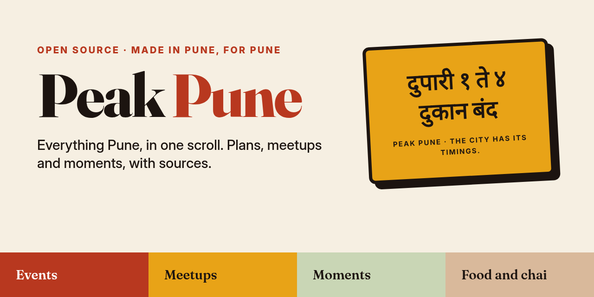
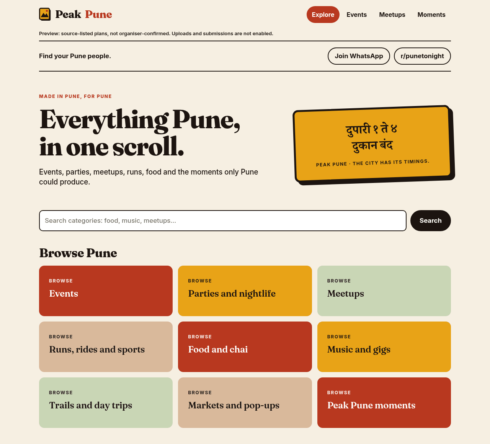
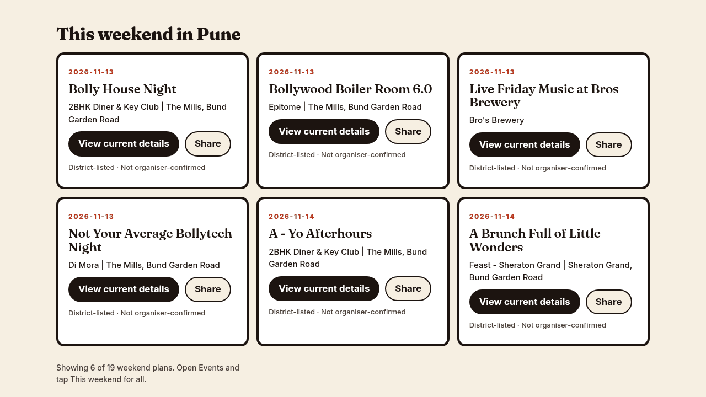
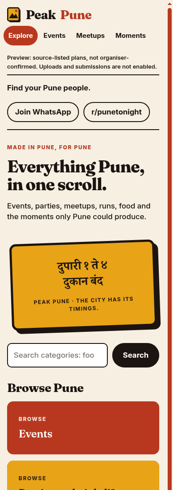
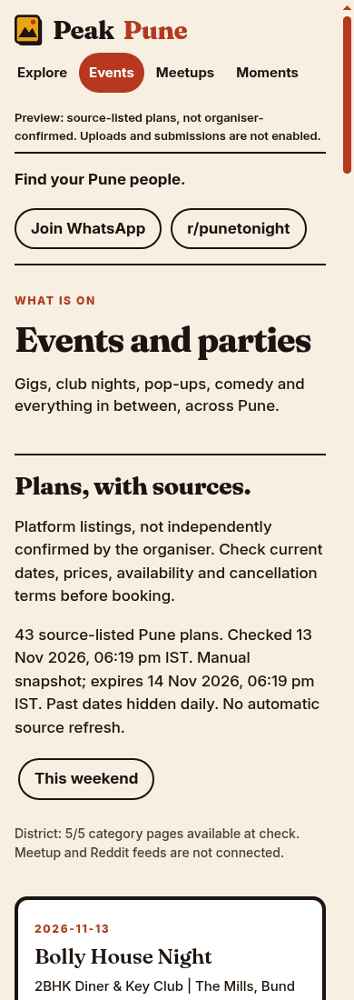
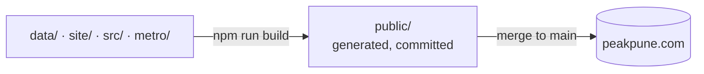

<p align="center">
  
</p>

<p align="center">
  <a href="https://peakpune.com/"><b>peakpune.com</b></a> &nbsp;·&nbsp;
  <a href="CONTRIBUTING.md">Contribute</a> &nbsp;·&nbsp;
  <a href="docs/SCOPE.md">Scope and brand</a> &nbsp;·&nbsp;
  <a href="docs/ARCHITECTURE.md">Architecture</a> &nbsp;·&nbsp;
  <a href="docs/REVIEWING.md">Review a PR</a> &nbsp;·&nbsp;
  <a href="CHANGELOG.md">Changelog</a> &nbsp;·&nbsp;
  <a href="SECURITY.md">Security</a>
</p>

<p align="center">
  
  
  
  
</p>

# Peak Pune

PeakPune is an open-source Pune city guide for places to visit, local events, meetups, running routes, treks and Pune Metro journeys. It is a small static site: Astro-generated HTML and CSS, with TypeScript validation and a Svelte island for plans.
The pages are static, with no build on deploy. Plan posting and the owner's review page run on a small Cloudflare Pages Functions backend (`functions/`).

> **Status: live.** Listings are source-checked, not a promise of current availability.
> Search indexing is on. Visitors can send a plan on the Events page, and a person reviews every plan before it shows. A salted hash of the visitor's IP address is stored for spam limits and to limit repeat "going" taps and reports from the same IP address. It is never published. See SECURITY.md.

## Contribute in 10 minutes

Peak Pune is about Pune, and contributors from Pune and across India are warmly welcome. Anyone can help. New here? Pick a task labelled [good first issue](https://github.com/peakpune/peakpune/labels/good%20first%20issue), fork the repo, make one small change and open a pull request. You do not need Write access, and nothing is pushed straight to `main`.

1. Fork, then `git clone` your fork and run `npm ci`.
2. Make one small change. Listings need a public source link, never a guess.
3. Run `npm test` and `npm run build`, then open a pull request that says what you changed and why.

## What works today

| Area | State |
| --- | --- |
| **Explore** | A "This weekend in Pune" section built from real listings, featured places, runs and treks. |
| **Places** | 28 source-backed Pune places, with one page each and pages by area. Unconfirmed hours and prices are omitted. |
| **Outdoors** | 8 mapped running loops and 20 treks and day trips with sourced distance and drive-time details where available, credited to PuneRunners Club and Pune Trekkers. |
| **Events** | A reviewed snapshot of Pune plans listed on District, each linking to its original listing. A **This weekend** filter uses only the listed date. A **Share** button on each plan shares or copies the original link. |
| **Meetups** | 7 communities with current source evidence and public joining pages. Unconfirmed activity listings are withheld. |
| **Moments** | No genuine submitted moments published yet. Generated captions removed. Moments has no submission form; the plans form on Events is separate. |
| **Submissions, uploads, accounts** | Visitors can submit plans with an optional image; each is approved by the owner before it shows. No visitor accounts. |

Plans are source-listed, not confirmed by organisers. Always check the original listing for
current dates, prices and availability. Nothing here promises live availability, and unknown
prices are never shown as "Free".

The publication decisions and corrections are recorded in [`docs/LISTING-AUDIT.md`](docs/LISTING-AUDIT.md). Original source rows are retained for review, but only IDs explicitly approved in `data/publication-audit.json` reach the public pages.

## A look

<p align="center">
  
</p>

<p align="center">
  
</p>

<p align="center">
  
  &nbsp;&nbsp;
  
</p>

<sub>Earlier screenshots taken on 13 November 2026 before the listing audit. They are historical, not evidence of current published content.</sub>

## Pune Metro guide

`/PuneMetroguide/` is a plain-language guide to the Pune Metro (Purple, Aqua and Line 3) with a journey planner that works
offline after one visit: which line, where to change and what the ticket costs, for any two stations that are open. Lines 1 and 2 are
operator-confirmed; Line 3 stations are reported open by the media (the operator publishes no open/closed list) and are
labelled that way. Data lives in [`data/metro/`](data/metro/README.md) (checked against both operators, with a dated
verification log). The planner is a small [Gleam](https://gleam.run) program using Lustre, in [`metro/`](metro/README.md),
compiled to a committed bundle. The page is an Astro route; its script is strict TypeScript. A service worker scoped to
`/PuneMetroguide/` only caches the guide. Timetable information only: there are no live trains. `npm run metro:check`
validates the data, `npm run metro:offline` runs the browser checks (needs Playwright with Chromium).

## Pune right now and add to calendar

- **Home page strip** ("Pune right now"): AQI (US scale) and PM2.5, next-hour temperature and rain chance, sunrise and sunset, moonrise, moonset and phase. Weather and air quality are fetched in the visitor's browser from [Open-Meteo](https://open-meteo.com/) (no key, nothing stored, attribution shown). Moon times are computed on the device (`src/client/astro.ts`) and labelled approximate; they were checked against an independent library over 31 days, within about 12 minutes. The strip stays hidden if both services fail.
- **Events**: every dated organiser card has "Add to Google Calendar" and a downloadable `.ics`, plus one `.ics` for all dated listings. Entries are timed only where the source gave an exact start, otherwise all-day; no end time is invented; partial listings are marked tentative. Files are built into `public/calendar/` by `scripts/calendar.mjs`.

## Stack and deployment

- **TypeScript:** strict typed publication gate, District URL/snapshot boundary, IST dates, weekend filtering and sharing. Runtime checks still reject untrusted JSON. Types do not prove listing truth.
- **Astro:** static routes and shared document layout for all 74 canonical pages plus 404. The existing reviewed content renderer is retained behind that layout; this is an incremental migration, not rewritten listing facts.
- **Svelte:** only the existing plans cards, weekend filter and share UI hydrate on home and Events. Other pages have no Svelte island. No new backend or unasked features.

`npm run build` compiles TypeScript, generates Astro HTML and copies the complete static result into committed `public/`. Existing Cloudflare Pages can keep deploying that folder with no build command. Do not change the production build settings or add an SSR adapter/Functions. The stack upgrade does not fix a separate Cloudflare publishing incident.

`npm run check` checks Astro/Svelte/TypeScript. `npm test` runs the regression suite. CI installs the lockfile, runs both, rebuilds and checks committed output has not drifted. Only IDs explicitly allowed by the publication audit publish; indexing is on, and plan submissions are reviewed before they publish. The manual snapshot expiry is unchanged.

The tools are build-time dependencies, not a paid runtime. Static hosting still depends on the current free plan limits. Paid APIs, databases and server rendering are not enabled. See [`docs/STACK.md`](docs/STACK.md) for maintenance notes.

## Run it locally

You need Node.js 22.23.4+ and Python 3. Run `npm ci` once to install the pinned build tools.
`npm run dev` builds the static output, then serves it locally.

```sh
git clone https://github.com/peakpune/peakpune.git
cd peakpune
npm ci            # installs pinned build tools
npm run check     # checks TypeScript, Astro and Svelte
npm test          # runs all tests
npm run dev       # serves public/ at http://localhost:4173
```

## How it is put together

Edit **data and source files**, run one command, commit the generated `public/`, and the site deploys. The full
picture, with diagrams, is in [`docs/ARCHITECTURE.md`](docs/ARCHITECTURE.md).



| Folder | What lives there | Edit by hand? |
| --- | --- | :---: |
| [`data/`](data/README.md) | Sourced datasets, the publication audit, Pune Metro data | Yes |
| [`site/`](site/README.md) | Page fragments, metro stylesheet, service-worker template | Yes |
| [`src/`](src/README.md) | Strict TypeScript, the Svelte plans island, Astro routes and layout | Yes |
| [`metro/`](metro/README.md) | Gleam and Lustre journey planner (`dist/planner.js` is the committed bundle) | Yes (not `dist/`) |
| [`scripts/`](scripts/README.md) | Build, validators, calendar, offline browser check | Yes |
| [`tests/`](tests/README.md) | `node:test` suites | Yes |
| [`docs/`](docs/README.md) | Scope and brand, architecture, review guide, audits, research | Yes |
| `functions/`, `migrations/` | The **live** plan-posting backend (Cloudflare Pages Functions + D1 schema). Serves /api/plans and the owner's /backend review page. See the note below. | Yes (carefully; run the tests first) |
| `public/` | **The deployed site.** Generated pages, bundles, `.ics`, sitemap. Hand-written: `tokens.css`, `app.js`, `fonts/`, `data/plans.json`, `_headers` (response headers / CSP) | Only the exceptions |
| `peakpuneapp/`, `punepedia/` | Separate Android projects, not part of the site build or deploy | n/a |

**How pages are made.** `public/` is served as plain files. Its HTML is written by
`npm run build` from `site/` and `data/` and then committed, so there is nothing to build on
deploy. Edit `site/` or `data/`, run the build, commit the result. Pages are generated for
search indexing by default; `INDEXING=off npm run build` builds a `noindex`
copy without the sitemap reference. Set `SITE_URL` if the origin is not
`https://peakpune.com`.

**How plans get on the page.** A person runs the export by hand (see
[`docs/PLANS.md`](docs/PLANS.md)), reviews it, and commits `public/data/plans.json`. The
snapshot expires after 24 hours and the page hides it once it expires, and hides past dates
each day. Visitors' browsers never call event providers. There is no automatic refresh.

**Safety by default.** Event text is untrusted and escaped by Svelte (never rendered as raw HTML). Source URLs
are validated and original links are kept. `src/abuse-guard.js` (a honeypot field, an hourly
per-IP limit and an entry cap, adapted from PuneAfterhours) is live in the plan-submission
backend in `functions/`.

**About `functions/` (live).** The site's plan-posting backend lives here (Cloudflare Pages
Functions: submit, going, report, owner review) with a D1 schema in `migrations/`. It is not bundled by
`npm run build`. It needs a `DB` binding, an `ADMIN_PASSPHRASE` and a `HASH_SALT`. Every submitted plan
starts as pending and shows only after the owner approves it. If you are assessing the live security
surface, this backend and the /backend review page are the parts to audit. See SECURITY.md.

## Brand

Peak Pune keeps its brand kit: Chai Ink `#1C1410`, Peth Paper `#F6EFE2`, Wada Brick
`#B8381F`, Haldi `#E8A317`, Mutha Sage `#C9D6B5` and Misal Clay `#D9B99B`, set in Fraunces
and Inter. Full rules and how the interface applies them are in
[`docs/SCOPE.md`](docs/SCOPE.md).

## Roadmap

Planned, not built. Anything involving people's content needs moderation and privacy
review first.

- [ ] Events: Pune areas, categories and a free-entry filter, once the data can prove it
- [x] Meetups: real communities with verified joining links (first 13)
- [ ] Places and outdoors: lift coverage beyond the first sourced batches in `data/`
- [ ] Moments: Patya, Traffic, Food, Language, Weather, Timings
- [ ] Submissions with consent, credit, reporting, spam and upload controls, and a human
      moderation queue before anything is public
- [ ] Additional event sources, only where the provider's terms allow it

## Contribute

Fork this repository (or branch, if you have Write access) and open a pull request. Never
push straight to `main`: it deploys the live site. Keep changes small, run `npm test`, and
include mobile and desktop screenshots for interface changes. Steps and brand rules are in
[`CONTRIBUTING.md`](CONTRIBUTING.md).

Do not commit credentials, personal data or unlicensed work. Never auto-publish community
submissions. Additional providers and recurring refresh need review before enabling. Found a
security problem? Read [`SECURITY.md`](SECURITY.md) and do not open a public issue.

## Credits and licence

Code is MIT, see [`LICENSE`](LICENSE). Font licences are in `public/fonts/`. The Pune
parsers were adapted from the owner's PuneAfterhours project; attribution is in
`src/discovery.js` and [`docs/THIRD-PARTY.md`](docs/THIRD-PARTY.md). The Peak Pune brand
concept came from owner-supplied designs.
