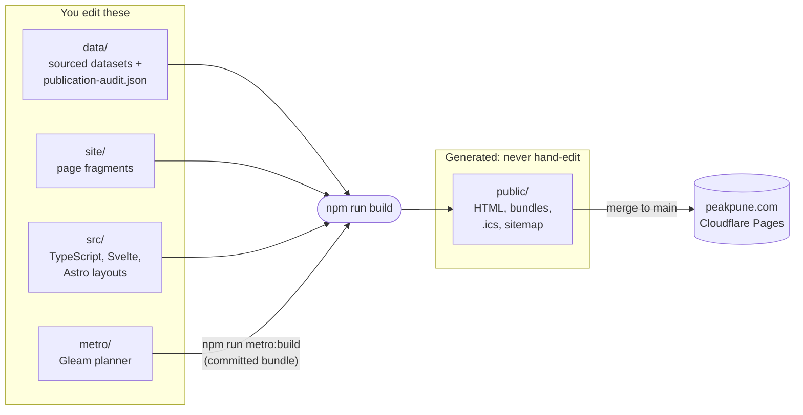
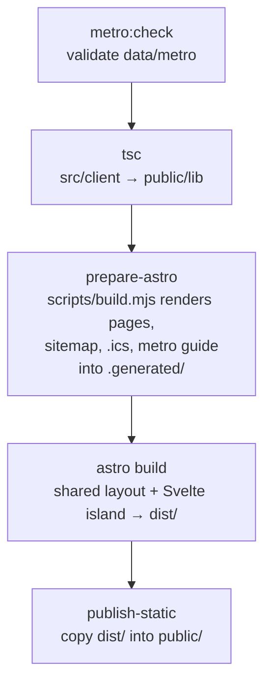
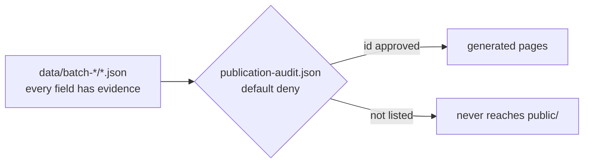
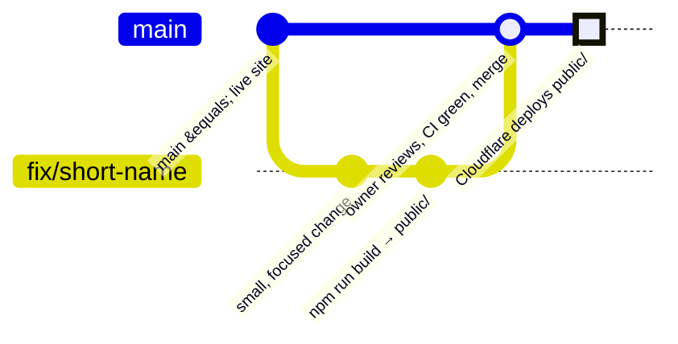

# How Peak Pune is put together

A static site with no backend. People edit **data and source files**; one command turns them into plain
HTML in `public/`; the generated folder is committed; Cloudflare Pages serves it. This page is the map.

## The 60-second picture

## What `npm run build` does

CI runs the same steps and then fails if `git diff -- public/` is not empty, so committed output can never
drift from its sources.

## Hand-written or generated?

This is the question that decides how to review a pull request.

| Where | Hand-written | Generated (do not edit; collapsed in PR diffs) |
| --- | --- | --- |
| `data/` | Everything. Datasets, `publication-audit.json`, per-batch READMEs. | none |
| `site/` | Everything. HTML page fragments and the metro stylesheet and worker template. | none |
| `src/` | Everything. `client/` strict TypeScript, `components/` Svelte, `pages/` and `layouts/` Astro. | none |
| `scripts/` | Everything. The build, validators and the offline browser check. | none |
| `tests/` | Everything. `node:test` suites. | none |
| `metro/` | `src/*.gleam`, `test/`, `gleam.toml`, `entry.mjs`, README. | `dist/planner.js`, `src/peakpune_metro/data.gleam`, `ids.gleam` |
| `public/` | `tokens.css`, `app.js`, `plans.js`, `filters.js`, `share.js`, `fonts/`, `og.png`, `data/plans.json` (reviewed snapshot) | all `*.html`, `_astro/`, `lib/`, `calendar/`, `PuneMetroguide/*.js`, `sitemap.xml`, `robots.txt`, `site.webmanifest`, `icon.svg` |
| `peakpuneapp/`, `punepedia/` | Separate Android projects. Not part of the site build or deploy. | none |

## Data to page: the publication gate

- A row appears on the site only if its id is approved in `data/publication-audit.json`.
- Unknown values stay unknown (`null` or `"UNKNOWN"`). Nothing is guessed, and a missing price is never shown as "Free".
- Every datum keeps its source link and the date it was checked.

## The three client-side features

None of these needs a server. The page works without JavaScript; each feature only adds to it.

| Feature | Code | Notes |
| --- | --- | --- |
| **Plans** (events snapshot, weekend filter, share) | `src/components/`, `src/client/snapshot.ts`, `public/data/plans.json` | Reviewed snapshot that expires in 24 h and hides itself. Visitors' browsers never call event providers. |
| **Pune right now** (AQI, next-hour temperature, sun and moon) | `src/client/pune-now*.ts`, `src/client/astro.ts` | The visitor's browser asks Open-Meteo directly. Moon times are computed on the device. Hidden if the services fail. |
| **Pune Metro guide** (`/PuneMetroguide/`) | `scripts/metro-guide.mjs`, `metro/` (Gleam + Lustre), `src/client/metro-guide.ts`, service worker | Journey planner works offline after one visit. The worker is scoped to the guide only. |

Add-to-calendar needs no script at all: `scripts/calendar.mjs` writes the Google Calendar links and `.ics`
files at build time.

## Branches and deploys

- **`main` is the live site.** A merge deploys https://peakpune.com/. Never push straight to it.
- Every pull request gets a Cloudflare preview URL and runs `npm test` (tests, type checks, build, drift check).
- Branch names: `feat/…`, `fix/…`, `docs/…`, `data/…`. One idea per pull request.

See [`REVIEWING.md`](REVIEWING.md) for how to review one quickly, and [`STACK.md`](STACK.md) for why these tools.
